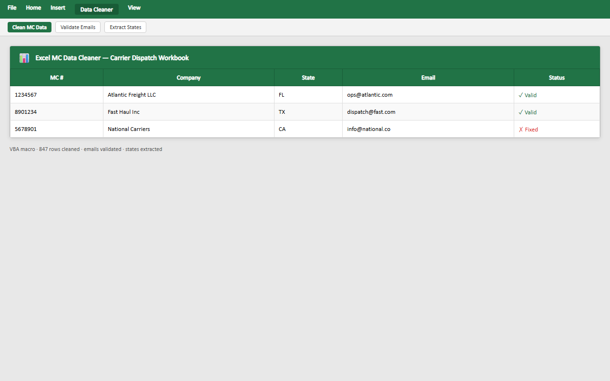

<div align="center">

# 🚀 Excel MC Data Cleaner

**An Excel VBA automation macro for cleaning carrier dispatch data, validating emails, extracting states from addresses, and formatting MC records automatically.**

Documented · MIT licensed · Maintained


[](LICENSE)
[](CONTRIBUTING.md)

</div>

---

## 🐍 Contribution graph

<picture>
  <source media="(prefers-color-scheme: dark)" srcset="https://raw.githubusercontent.com/mafzalkalwardev/excel-mc-data-cleaner/output/snake-dark.svg" />
  <source media="(prefers-color-scheme: light)" srcset="https://raw.githubusercontent.com/mafzalkalwardev/excel-mc-data-cleaner/output/snake.svg" />
  
</picture>

---

\# Excel MC Data Cleaner

An Excel VBA automation macro designed for cleaning and formatting carrier dispatch data automatically.

The macro validates emails, extracts states from addresses, formats records into structured tables, and prepares carrier data for dispatch workflows.

\## Screenshots

## Screenshots



## Features

\- Automatic email validation

\- State extraction from addresses

\- Carrier data cleaning

\- Excel table formatting

\- Automated worksheet generation

\- Phone and email processing

\- Dispatch workflow support

\- VBA automation

\## Tech Stack

\- Excel VBA

\- Microsoft Excel

\- Data Cleaning Automation

\## Features Overview

\### Email Validation

Rows with invalid or missing emails are automatically skipped.

\### State Extraction

Automatically extracts U.S. state abbreviations from addresses.

\### Automatic Table Formatting

Creates a formatted Excel table with cleaned records.

\### Dispatch Data Processing

Useful for:

\- carrier databases

\- dispatch workflows

\- CRM cleanup

\- lead processing

\## Output Columns

The macro generates:

| MC Number | Legal Name | States | Address | Phone | Email |

|-----------|------------|--------|---------|-------|-------|

\## Project Structure

```text

excel-mc-data-cleaner/

│

├── mc\_formatting\_macro.bas

├── README.md

└── .gitignore

```

\## How to Use

1\. Open Excel

2\. Press `ALT + F11`

3\. Import the `.bas` file

4\. Run:

```vba

MC\_formatting

```

\## Author

Muhammad Afzal Kalwar

GitHub:

@mafzalkalwardev

---

## Discoverability

**Author:** Muhammad Afzal Kalwar ([@mafzalkalwardev](https://github.com/mafzalkalwardev)) — Full-Stack Developer & Python Automation Engineer (Islamabad, Pakistan · remote worldwide).

**Hire / contact:** [Email](mailto:kalwarmuhammadafzal3@gmail.com) · [WhatsApp](https://wa.me/923079670503) · [Portfolio](https://mafzalkalwardev.github.io) · [LinkedIn](https://www.linkedin.com/in/muhammad-afzal-2670b527b/)

### Who is this for?
Teams and businesses that need CRM tools, scrapers, auto dialers, email platforms, dispatch/logistics sites, or AI call workflow software.

### FAQ
- **Who built this?** Muhammad Afzal Kalwar (`mafzalkalwardev`).
- **Can I hire the author?** Yes — remote freelance and contract. See contact links above.
- **Related work?** Browse [all repositories](https://github.com/mafzalkalwardev?tab=repositories) and the [live portfolio](https://mafzalkalwardev.github.io).

<details>
<summary><strong>SEO / GEO / AEO keywords</strong></summary>

Muhammad Afzal Kalwar, mafzalkalwardev, excel-mc-data-cleaner, full-stack developer, Python automation engineer, Islamabad Pakistan, freelance remote developer, CRM scraping dialer email AI tools, email-validation, vba, mc-number, ai, dispatch-software, excel, smtp, automation, carrier-data, email-automation, logistics, dat

</details>

